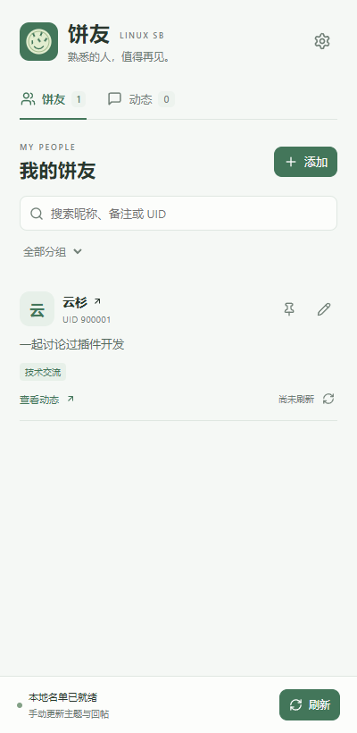
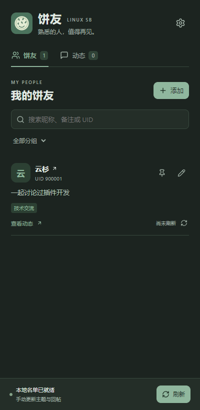

# 饼友 · 烧饼社区

为 [烧饼站 linux.sb](https://linux.sb/) 提供本地饼友名单、备注与动态聚合的 Chrome / Edge 扩展。

遇到想继续关注的人，在他的个人主页点「加入饼友」，记下你们为何相识；下次打开侧栏，就能集中查看这些人的主题和回帖摘要。

**当前版本：0.1.1 · MVP**，采用 Manifest V3，支持 Chrome / Edge 120 及以上版本。尚未上架扩展商店。

## 界面预览

<table>
  <tr>
    <th>浅色侧栏</th>
    <th>深色侧栏</th>
  </tr>
  <tr>
    <td></td>
    <td></td>
  </tr>
</table>

截图使用测试用户和示例备注。

## 可以做什么

- **记住一个人**：个人主页一键加入，或在侧栏输入 UID / 主页链接添加。
- **整理关系**：备注、分组、置顶，以及昵称、备注和 UID 搜索。
- **集中看动态**：聚合主题和回帖摘要，按用户、分组和类型筛选，点击返回原帖。
- **按需更新**：手动刷新、单人刷新、停止和更早分页，失败时保留已有数据。
- **轻量页面标记**：只在昵称旁显示绿色「饼友」标记，悬停查看备注；主页按钮对齐原站操作按钮。
- **备份名单**：JSON 导出、导入预览和冲突处理。
- **深浅色适配**：低饱和度绿色界面，侧栏跟随系统主题。

名单和备注保存在当前浏览器配置的扩展本地存储中。加入饼友不会改变原站关注关系，对方也不需要安装扩展。

## 安装：先构建，再加载扩展

需要 **Node.js 22 或更高版本**、npm，以及 Chrome / Edge 120 或更高版本。

```sh
git clone https://github.com/ikurt234outlook/sb-friends.git
cd sb-friends
npm ci
npm run build
```

1. Chrome 打开 `chrome://extensions`，或 Edge 打开 `edge://extensions`。
2. 开启「开发者模式」，点击「加载已解压的扩展程序」。
3. 选择刚构建的 **`sb-friends/dist`** 文件夹，里面应直接包含 `manifest.json`。
4. 打开或刷新 [烧饼站](https://linux.sb/)，进入一个用户的个人主页，点击「＋ 加入饼友」。
5. 点击浏览器工具栏里的「饼友」图标，或网页内的「饼友」入口打开侧栏，点击「刷新」。刷新时保留至少一个烧饼站标签页。

`dist/` 和 `packages/` 是本地生成目录，不随 Git 提交。GitHub 的 **Download ZIP 是源码包，不能直接加载为扩展**，解压后仍需运行构建命令。

### 生成可分发的安装包

```sh
npm run package
```

输出 `packages/sb-friends-0.1.1-chrome-edge.zip`。接收者解压到固定文件夹后，按上述步骤加载包含 `manifest.json` 的目录，无需安装 Node.js。

### 更新已安装的扩展

建议先在扩展设置中导出名单备份，然后在原源码目录运行：

```sh
git pull --ff-only
npm ci
npm run build
```

保持安装路径不变，在扩展管理页点击「重新加载」，**再刷新烧饼站网页**，使页面脚本也更新。

## 日常使用

- **添加**：侧栏点击「添加」，输入数字 UID 或 `https://linux.sb/user/UID`，预览资料后确认。名单最多 200 人。
- **备注与分组**：点击铅笔或备注文字。备注最多 80 个字符；分组用逗号分隔，每人最多 10 组。图钉将常用饼友置顶。
- **动态与分页**：在「动态」中筛选用户、分组、主题或回帖。选择一位用户后，可读取更早主题或回帖。
- **刷新与停止**：全部或单人手动刷新，请求串行且起始间隔至少 2 秒；最新页成功后 5 分钟内可复用缓存。历史分页不延长最新页缓存。停止时保留已完成的结果。
- **导入与导出**：设置中导出 JSON，只包含名单、备注、分组和置顶。导入先显示新增与冲突数量，默认保留已有条目，显式选择覆盖后才替换。
- **清理缓存**：只删除动态，不删除名单和备注。动态合并时保留最近 30 天、每人最多 100 条、全局最多 2000 条；历史分页同样受这些上限约束。

动态时间标注为「原站」，来自用户列表的时间字段。详情页仅提供相对时间，精确创建时间语义尚未完全核实；扩展不显示“最后在线”。

## 数据与权限

扩展仅申请：

| 权限 | 用途 |
| --- | --- |
| `storage` | 保存本地名单、备注、缓存和刷新状态 |
| `sidePanel` | 打开浏览器侧栏 |
| `https://linux.sb/*` | 注入页面入口，通过已打开的站点页面读取用户可见内容 |

没有后端、云同步、遥测或后台自动轮询。取数使用当前站点会话，不读取或导出 Cookie；头像按原站 URL 加载。扩展不自动发帖、回复、点赞或关注。完整说明见 [数据与访问说明](docs/隐私说明.md)。

**多账号注意**：数据按浏览器配置保存，当前不会按烧饼站账号分库。退出登录后旧缓存仍可见；切换账号后可在设置中清理动态缓存。账号切换隔离尚未实测。

## 遇到问题

| 提示或现象 | 处理方式 |
| --- | --- |
| 请先打开烧饼站 | 打开 `https://linux.sb/` 后重新刷新动态 |
| 无法连接烧饼站页面 | 重新加载扩展后，再刷新原站网页 |
| 页面需要登录或验证 | 在原站手动处理，然后重试；已有缓存保留 |
| 请求过于频繁 | 等待站点指定的冷却时间；未指定时冷却 10 分钟 |
| 部分更新 | 成功类型已保存，失败类型保留旧数据，处理连接问题后重试 |
| 页面结构变化 | 本轮会停止并保留数据，请反馈页面 URL 和错误文字 |

问题可提交到 [Issues](https://github.com/ikurt234outlook/sb-friends/issues)。请提供扩展版本、浏览器版本、页面 URL、复现步骤和错误文字；不要上传 Cookie、完整个人备份或其他敏感信息。

## 开发与测试

技术栈：TypeScript、React 19、Jotai、Vite、esbuild，浏览器扩展 Manifest V3。

```sh
npm ci
npm test               # 单元测试
npm run build          # TypeScript 检查 + 扩展构建
npm run dev            # 仅预览 UI，不提供完整扩展环境
npm run package        # 构建并打包 ZIP
```

浏览器回归使用独立测试配置，不写入日常浏览器：

```sh
npx playwright install chromium
npm run test:browser
node scripts/appearance-check.mjs

# 可选：访问三个公开用户页进行真实站点取数验证
node scripts/browser-check.mjs --live
```

可用 `SB_TEST_BROWSER` 指定测试浏览器可执行文件，`SB_TEST_PROXY` 指定已有代理；默认不设置代理，也不修改系统网络配置。测试报告和截图输出到 `.qa/evidence/`；独立浏览器配置位于 `.qa/profiles/`，不提交到 Git。

### 工程结构

```text
src/
  background/    消息入口、统一存储写入、请求队列、缓存和取消
  content/       页面按钮、昵称标记和页面读取消息
  domain/        名单、备注、缓存合并和备份规则
  shared/        类型、UID 和 URL 规则
  site/sb/       烧饼站 HTML 解析与同源请求
  ui/            侧栏和选项页
scripts/         构建、打包和浏览器验证
public/          图标源文件
docs/            设计、验收和隐私说明
```

状态流：页面或侧栏发出命令 → 后台校验与排队 → 站点 content script 同源读取 HTML → 解析为结构化数据 → 后台统一写入 → 页面和侧栏更新。

## 已验证范围与当前限制

已通过 17 项单元测试、TypeScript 构建，以及独立 Chromium / Edge 配置中的核心交互回归。真实站点使用访客模式验证了三位公开用户的取数；页面集成修正另有昵称选择和按钮尺寸检查。完整证据与各轮范围见 [MVP 验收记录](docs/饼友-MVP验收.md)。

仍需现场验证的内容包括登录账号的受限内容、多账号切换，以及日常浏览器中的原生侧栏外壳。当前没有 Firefox 版本、自动刷新、通知、云同步或 Telegram 集成。

## 参考与许可证

项目参考 [LeUKi/linuxdo-friends（佬朋友）](https://github.com/LeUKi/linuxdo-friends) 的侧栏、备注和本地状态交互。烧饼站不是 Discourse，本项目单独实现站点解析、数据模型和页面适配。

备注规范化函数改编自其 MIT 源码，保留原作者版权声明。详见 [MIT 许可证](LICENSE)、[第三方说明](THIRD_PARTY_NOTICES.md) 和 [设计文档](docs/饼友-插件设计.md)。安装包包含相关依赖的许可证。
